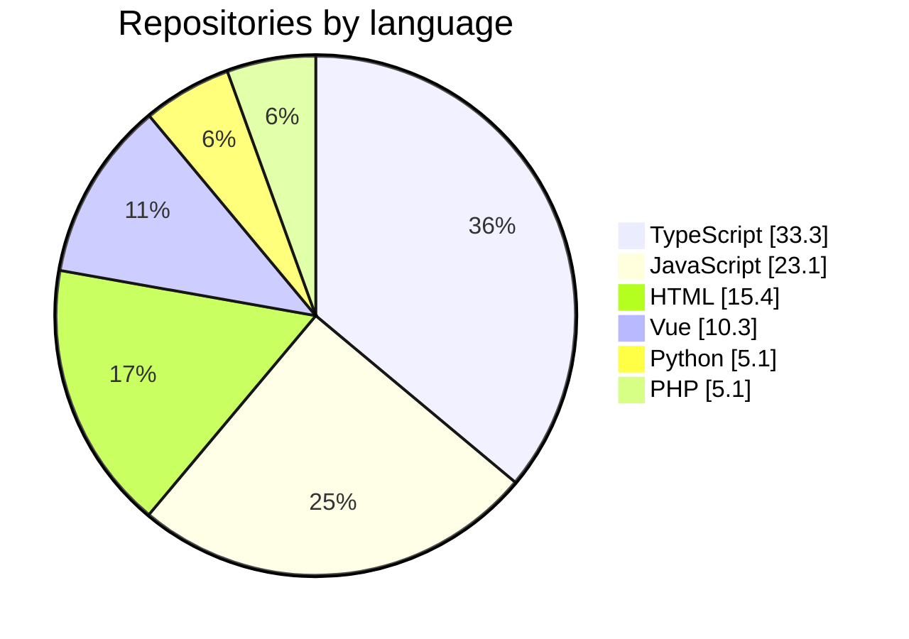
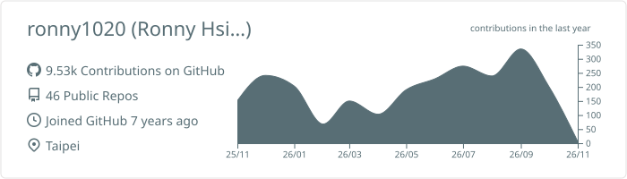
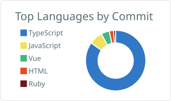
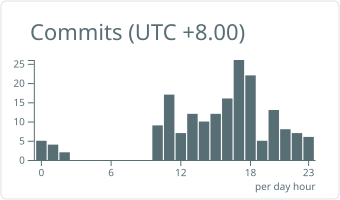

<h1 align="center">Hi there, I'm Ronny Hsieh 👋</h1>

  Front-end developer in Taipei 🇹🇼 — TypeScript, Vue &amp; React, and 3D in the browser.

<h3 align="center">☁️ Hello from Taipei — grey and overcast today, 19–28&nbsp;°C.</h3>

🌅 6:08 AM · 🌇 5:07 PM · ☀️ 10&nbsp;h 59&nbsp;m of daylight, 1 minute shorter than yesterday 
🌒 waxing crescent tonight · 🌊 the sea off Keelung is 25&nbsp;°C, waves up to 1.8&nbsp;m 
🟡 peak US AQI 59, moderate

  <picture>
    <source media="(prefers-color-scheme: dark)" srcset="https://raw.githubusercontent.com/ronny1020/ronny1020/master/live-badge/dark.svg">
    
  </picture>

  
  
  

  <b>409,737</b> npm installs in the last year · <b>7</b> pull requests merged into projects with <b>146,263</b> stars between them · <b>58</b> Stack Overflow answers, <b>17</b> accepted, <b>881</b> reputation · <b>484</b> commits maintaining a community docs site · <b>48</b> stars on my own repositories · on GitHub since <b>2019</b>

## 🧑‍💻 About me

  

- 🎨 Front-end developer who cares about design systems, accessibility, and code that reads well.
- 🛰️ Day to day I build web apps for a computer-vision / digital-twin platform — React, Next.js, Vue, Vite, and a fair amount of 3D rendering in the browser.
- 📦 I publish small, focused npm packages and use them in my own work.
- 💬 Issues and pull requests on any of my repositories are always welcome.

🔨 Lately I'm mostly pushing to [**muster**](https://github.com/ronny1020/muster) — Run AI agent CLIs in tabs, each a real terminal with its own directory and git… 15&nbsp;pushes in 14&nbsp;days

## 📥 Packages people install

| Package                                                                      | What it is                                        | Installs / month |
| ---------------------------------------------------------------------------- | ------------------------------------------------- | ---------------- |
| [`react-json-formatter`](https://www.npmjs.com/package/react-json-formatter) | Formatting json data to JSX of React              | 38,779           |
| [`lorem-ipsum-tc`](https://www.npmjs.com/package/lorem-ipsum-tc)             | Tool for creating Traditional Chinese lorem ipsum | 171              |

…and 8 smaller packages

## 📦 Featured projects

| Project                                                                                                                                                               | What it does                                  | Installs |
| --------------------------------------------------------------------------------------------------------------------------------------------------------------------- | --------------------------------------------- | -------- |
| [**condition-switch**](https://github.com/ronny1020/condition-switch) ⭐&nbsp;5 · TypeScript · [v0.1.2](https://www.npmjs.com/package/condition-switch) | A condition switch library for js/ts          | 95/mo    |
| [**react-form-maker**](https://github.com/ronny1020/react-form-maker) ⭐&nbsp;2 · JavaScript · [v0.4.0](https://www.npmjs.com/package/react-form-maker) | NPM React tool to make a React form by object | 67/mo    |
| [**nekoChannelLineBot**](https://github.com/ronny1020/nekoChannelLineBot) ⭐&nbsp;1 · TypeScript                                                        | —                                             | —        |
| [**podcast-player-demo**](https://github.com/ronny1020/podcast-player-demo) ⭐&nbsp;1 · Vue                                                             | —                                             | —        |

## 🏷️ Latest releases

- [**muster** v0.8.2](https://github.com/ronny1020/muster/releases/tag/v0.8.2) Nov&nbsp;6,&nbsp;2026
- [**channel-state** v0.1.0](https://github.com/ronny1020/channel-state/releases/tag/v0.1.0) Jun&nbsp;28,&nbsp;2026

## 🤝 Upstream contributions

7 pull requests merged into repositories I do not own:

- **[TanStack/query](https://github.com/TanStack/query)** ⭐&nbsp;50,569  [docs(query-react): Update links in useQuery documentation](https://github.com/TanStack/query/pull/11006) merged Aug&nbsp;17,&nbsp;2026
- **[logicspark/awesome-vitepress-v1](https://github.com/logicspark/awesome-vitepress-v1)** ⭐&nbsp;196  [feat(docs): add `travel-guide-tw.github.io/` blog](https://github.com/logicspark/awesome-vitepress-v1/pull/15) merged Apr&nbsp;6,&nbsp;2025
- **[cypress-io/cypress-documentation](https://github.com/cypress-io/cypress-documentation)** ⭐&nbsp;1,051  [docs(selectFile): readFile & fixture should use `null` instead of `{ encoding: null }`](https://github.com/cypress-io/cypress-documentation/pull/5563) merged Nov&nbsp;17,&nbsp;2023
- **[pixijs/pixijs](https://github.com/pixijs/pixijs)** ⭐&nbsp;48,671  [fix(application): prevent reading property of null if the application is destroyed](https://github.com/pixijs/pixijs/pull/9514) merged Jul&nbsp;6,&nbsp;2023
- **[react-hook-form/react-hook-form](https://github.com/react-hook-form/react-hook-form)** ⭐&nbsp;44,917  [fix(path): keys of `Date | FileList | File` shouldn't be add to the `PathImpl`](https://github.com/react-hook-form/react-hook-form/pull/8804) merged Aug&nbsp;8,&nbsp;2022
- **[visgl/loaders.gl](https://github.com/visgl/loaders.gl)** ⭐&nbsp;859  [docs(pcd): fix pcd-loader example `PCDloader` spell](https://github.com/visgl/loaders.gl/pull/2226) merged Aug&nbsp;1,&nbsp;2022

## 🐛 Bugs I reported that got fixed

Issues I opened in other people's projects that the maintainers labelled a bug and then fixed.

- **[francoismassart/eslint-plugin-tailwindcss](https://github.com/francoismassart/eslint-plugin-tailwindcss)** ⭐&nbsp;2,072  [The `font-mono` is considered not a tailwind class with the `fontFamily` setting without mono setting in tailwind.config.js.](https://github.com/francoismassart/eslint-plugin-tailwindcss/issues/249) fixed Jun&nbsp;19,&nbsp;2023
- **[vuepress-theme-hope/vuepress-theme-hope](https://github.com/vuepress-theme-hope/vuepress-theme-hope)** ⭐&nbsp;2,534  [`vuepress-plugin-comment2` get '@internal/pagesData' imported error during build](https://github.com/vuepress-theme-hope/vuepress-theme-hope/issues/2899) fixed Mar&nbsp;15,&nbsp;2023
- **[francoismassart/eslint-plugin-tailwindcss](https://github.com/francoismassart/eslint-plugin-tailwindcss)** ⭐&nbsp;2,072  [It takes a lot of time to execute, especially `tailwindcss/classnames-order `](https://github.com/francoismassart/eslint-plugin-tailwindcss/issues/136) fixed Jun&nbsp;9,&nbsp;2022
- **[vuejs/eslint-plugin-vue](https://github.com/vuejs/eslint-plugin-vue)** ⭐&nbsp;4,588  [rule "vue/no-unused-properties" on <script setup> api component use prop from api defineProps in api computed ](https://github.com/vuejs/eslint-plugin-vue/issues/1643) fixed Oct&nbsp;5,&nbsp;2021

## 🗺️ The project I maintain

[**travel-guide-tw/travel-guide-tw.github.io**](https://github.com/travel-guide-tw/travel-guide-tw.github.io) — a community-written Chinese travel guide built with VitePress.

I have written 484 of the 535 human commits in it, across 124 merged pull requests, most recently on Aug&nbsp;29,&nbsp;2026, alongside 1 other contributor.

## 🚀 Recently pushed

| Repository                                                                                                                                               | What it does                                                                               |
| -------------------------------------------------------------------------------------------------------------------------------------------------------- | ------------------------------------------------------------------------------------------ |
| [**ai-agent-press**](https://github.com/ronny1020/ai-agent-press) TypeScript · pushed Sep&nbsp;5,&nbsp;2026                                | Beautiful, automated AI Agent documentation portal generator. Organize rules, skills, and… |
| [**twinlink**](https://github.com/ronny1020/twinlink) TypeScript · pushed Jul&nbsp;11,&nbsp;2026                                           | A lightweight toolkit for creating direct 1-on-1 browser-to-browser connections using…     |
| [**react-json-formatter**](https://github.com/ronny1020/react-json-formatter) TypeScript · pushed Feb&nbsp;27,&nbsp;2026                   | Formatting json data to JSX of React                                                       |
| [**pexels-wallpaper-auto-changer**](https://github.com/ronny1020/pexels-wallpaper-auto-changer) TypeScript · pushed Feb&nbsp;14,&nbsp;2026 | —                                                                                          |

## 🔭 Themes I keep starring

  
  
  
  
  
  
  
  
  
  

<b>🛠️ Tech stack</b> — the tools my own repositories actually depend on

  
  
  
  
  
  
  
  
  
  

<b>📊 GitHub in numbers</b> — profile cards

  <picture>
    <source media="(prefers-color-scheme: dark)" srcset="https://raw.githubusercontent.com/ronny1020/ronny1020/master/profile-summary-card-output/github_dark/0-profile-details.svg">
    
  </picture>

  <picture>
    <source media="(prefers-color-scheme: dark)" srcset="https://raw.githubusercontent.com/ronny1020/ronny1020/master/profile-summary-card-output/github_dark/2-most-commit-language.svg">
    
  </picture>
  <picture>
    <source media="(prefers-color-scheme: dark)" srcset="https://raw.githubusercontent.com/ronny1020/ronny1020/master/profile-summary-card-output/github_dark/4-productive-time.svg">
    
  </picture>

---

  Weather data by <a href="https://open-meteo.com/">Open-Meteo.com</a> · air quality from <a href="https://atmosphere.copernicus.eu/">CAMS</a> · sea data generated using E.U. <a href="https://marine.copernicus.eu/">Copernicus Marine Service</a> information

