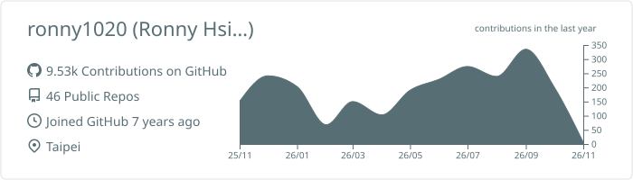
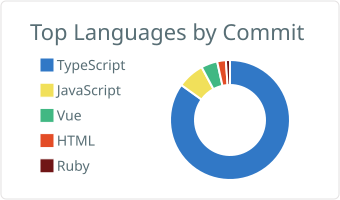
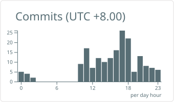

<h1 align="center">Hi there, I'm Ronny Hsieh 👋</h1>

  Front-end developer in Taipei 🇹🇼 — TypeScript, Vue &amp; React, and 3D in the browser.

<h3 align="center"><!-- generated:weather --></h3>

  <picture>
    <source media="(prefers-color-scheme: dark)" srcset="https://raw.githubusercontent.com/ronny1020/ronny1020/master/live-badge/sky-dark.svg">
    
  </picture>

<!-- generated:weatherFacts -->

  <picture>
    <source media="(prefers-color-scheme: dark)" srcset="https://raw.githubusercontent.com/ronny1020/ronny1020/master/live-badge/dark.svg">
    " src="https://raw.githubusercontent.com/ronny1020/ronny1020/master/live-badge/light.svg" height="24">
  </picture>

<!-- generated:social -->

<!-- generated:highlights -->

## 🧑‍💻 About me

- 🎨 Front-end developer who cares about design systems, accessibility, and code that reads well.
- 🛰️ Day to day I build web apps for a computer-vision / digital-twin platform — React, Next.js, Vue, Vite, and a fair amount of 3D rendering in the browser.
- 📦 I publish small, focused npm packages and use them in my own work.
- 💬 Issues and pull requests on any of my repositories are always welcome.

<!-- generated:currentWork -->

## 📥 Packages people install

<!-- generated:packages -->

## 📦 Featured projects

<!-- generated:featured -->

## 🏷️ Latest releases

<!-- generated:releases -->

## 🤝 Upstream contributions

<!-- generated:upstream -->

## 🐛 Bugs I reported that got fixed

Issues I opened in other people's projects that the maintainers labelled a bug and then fixed.

<!-- generated:fixedIssues -->

## 🗺️ The project I maintain

<!-- generated:maintained -->

## 🚀 Recently pushed

<!-- generated:recent -->

## 🔭 Themes I keep starring

<!-- generated:starTopics -->

<b>🛠️ Tech stack</b> — the tools my own repositories actually depend on

<!-- generated:techStack -->

<!-- generated:languages -->

<b>📊 GitHub in numbers</b> — profile cards

  <picture>
    <source media="(prefers-color-scheme: dark)" srcset="https://raw.githubusercontent.com/ronny1020/ronny1020/master/profile-summary-card-output/github_dark/0-profile-details.svg">
    
  </picture>

  <picture>
    <source media="(prefers-color-scheme: dark)" srcset="https://raw.githubusercontent.com/ronny1020/ronny1020/master/profile-summary-card-output/github_dark/2-most-commit-language.svg">
    
  </picture>
  <picture>
    <source media="(prefers-color-scheme: dark)" srcset="https://raw.githubusercontent.com/ronny1020/ronny1020/master/profile-summary-card-output/github_dark/4-productive-time.svg">
    
  </picture>

---

  Weather data by <a href="https://open-meteo.com/">Open-Meteo.com</a> · air quality from <a href="https://atmosphere.copernicus.eu/">CAMS</a>

